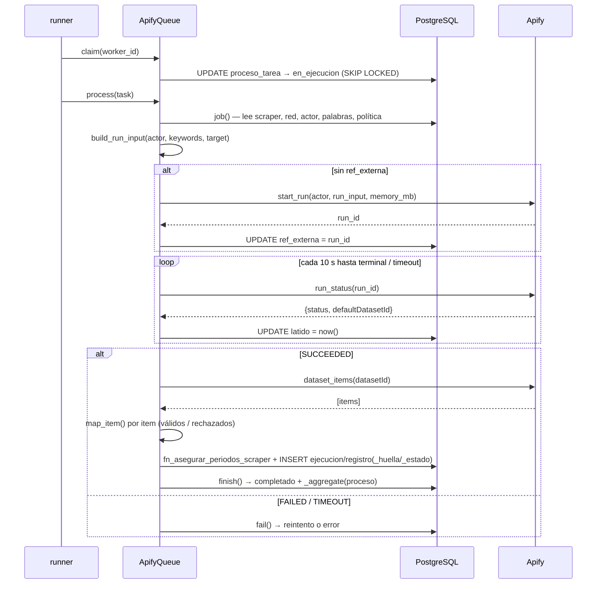

# Worker `q.apify` — scraping de redes vía Apify

> Documento vivo del consumidor de scraping. Acompaña al código en
> `worker/app/**` y al change-set de habilitación DEV en
> [`docs/worker-apify-dev.sql`](../../../docs/worker-apify-dev.sql).

## 1. Qué hace

`q.apify` es la cola durable que **lanza actores de Apify y persiste sus
resultados** en `dat.registro`, reutilizando la **misma identidad de URL y
deduplicación por huella** que la ingesta de archivos (`talkwalker_simple`). Así
un post scrapeado y el mismo post cargado por archivo colapsan en un único
registro.

Una ejecución de scraping la dispara el backend (`POST
/api/v1/scrapers/{id}/ejecutar`), que crea:

- un `prc.proceso` de tipo `carga_scraper`, y
- **una `prc.proceso_tarea` por cada red activa** del scraper
  (`cola='q.apify'`, `tipo='apify'`, `clave='red:<codigo>'`).

Google News (`tipo='googlenews'`, `clave='pais:<codigo>'`) **no se encola**
todavía porque no hay consumidor (ver §7).

El worker reclama tareas `tipo='apify'`, lanza el run del actor, **sondea** hasta
que el run termina y escribe el dataset. PostgreSQL es la cola: no hay Redis ni
microservicios.

## 2. Ciclo de vida de una tarea

```
en_cola ──claim()──▶ en_ejecucion ──_ensure_run()──▶ run Apify lanzado
                           │                              │
                           │  _poll() cada 10 s           │ renueva latido
                           ▼                              ▼
                      SUCCEEDED? ── no ──▶ fail() ──▶ reintento (en_cola) | error
                           │ sí
                           ▼
                      persist(dataset) ──▶ finish() ──▶ completado ──▶ _aggregate(proceso)
```

- **Reanudable**: el `run_id` de Apify se guarda en `proceso_tarea.ref_externa`.
  Si el worker pierde el lease a mitad del sondeo, al re-reclamar la tarea
  `_ensure_run()` reusa el mismo run en vez de lanzar (y pagar) otro.
- **Reintentos**: gobernados por `ops.politica_reintento('carga_scraper')`
  (`max_intentos`, `backoff_base_ms`, `backoff_max_ms`, `timeout_ms`). Sin esa
  fila válida el worker **se niega a operar** (`scrape_policy`).
- **Recuperación**: `recover()` detecta tareas `en_ejecucion` con `latido`
  vencido (`lease_seconds`, 900 s por defecto en q.apify) y las devuelve a
  `en_cola` o las marca `error` según el backoff.

## 3. Arquitectura (componentes)

```mermaid
flowchart LR
    subgraph FE["Frontend (SPA)"]
        PP["ProcessesPage.tsx"]
    end

    subgraph API["Backend FastAPI (rol syntra_api_login)"]
        RS["routers/scrapers.py<br/>POST /scrapers/{id}/ejecutar"]
        SVC["ScraperUseCases<br/>(application/service.py)"]
        PGW["PostgresScraperRuns<br/>(infrastructure/postgres.py)"]
    end

    subgraph DB[("PostgreSQL — DB + cola durable")]
        PROC["prc.proceso /<br/>prc.proceso_tarea (q.apify)"]
        CFG["med.scraper*, cfg.actor_scraping,<br/>cat.red, cat.origen, ops.politica_reintento"]
        DAT["dat.ejecucion, dat.registro,<br/>dat.registro_huella, dat.registro_estado"]
        FN["ops.fn_asegurar_periodos_scraper()<br/>(SECURITY DEFINER)"]
    end

    subgraph WK["Worker q.apify (rol syntra_scraper_worker_login)"]
        MAIN["main.py → CONSUMERS['q.apify']"]
        RUN["runner.run_consumer<br/>(ThreadPoolExecutor)"]
        AQ["ApifyQueue<br/>(infrastructure/apify_queue.py)"]
        DOM["domain/apify.py<br/>build_run_input / map_item"]
        PROV["ApifyScrapeProvider<br/>(infrastructure/apify_client.py)"]
    end

    APIFY[["Apify<br/>(actor runs + dataset)"]]
    TOKEN["token-file<br/>(SYNTRA_APIFY_TOKEN_FILE)"]

    PP -->|"ejecutar ahora"| RS --> SVC --> PGW -->|"INSERT proceso + tareas"| PROC
    MAIN --> RUN --> AQ
    AQ -->|"claim / recover / finish"| PROC
    AQ -->|"lee config + política"| CFG
    AQ -->|"persiste registros"| DAT
    AQ -->|"crea particiones"| FN
    AQ --> DOM
    AQ --> PROV
    PROV -->|"start / status / dataset"| APIFY
    PROV -.->|"lee token"| TOKEN
```

### Puertos y adaptadores (hexagonal)

| Capa | Archivo | Responsabilidad |
|---|---|---|
| **domain** | `domain/apify.py` | `build_run_input` (input schema por actor), `map_item` (dataset → fila `dat.registro`), `is_terminal`/`succeeded`. Puro, sin I/O. |
| **application** | `application/ports.py::ScrapeProvider` | Contrato mínimo de Apify: `start_run`, `run_status`, `dataset_items`. |
| **infrastructure** | `infrastructure/apify_queue.py::ApifyQueue` | Orquesta claim→run→poll→persist→finish contra PostgreSQL. |
| **infrastructure** | `infrastructure/apify_client.py::ApifyScrapeProvider` | Adapta el SDK `apify-client` al puerto. Import **perezoso**. |

## 4. Secuencia de una corrida



## 5. Normalización de datos (`domain/apify.py`)

- **`build_run_input`** conoce el *input schema* de los actores soportados y cae
  a un esquema genérico (`searchStringsArray`/`maxItems`) para el resto:

  | Actor | Claves de entrada |
  |---|---|
  | `apidojo/tweet-scraper` | `searchTerms`, `maxItems`, `sort=Latest` |
  | `clockworks/tiktok-scraper` | `searchQueries`, `resultsPerPage` |
  | `streamers/youtube-scraper` | `searchKeywords`, `maxResults`, `subtitles` |
  | `apify/instagram-scraper` | `search`, `searchType=hashtag`, `resultsLimit` |
  | *(genérico)* | `searchStringsArray`, `maxItems` |

  - **Cuotas**: el tope se acota a `min(scraper_red.registros, cfg.actor_scraping.max_registros)`
    y a `MAX_ITEMS_CEILING = 10 000`. La memoria del run se acota a
    `min(actor.memoria_mb, SYNTRA_APIFY_MAX_MEMORY_MB)`.
  - **Rechazo temprano**: actores sin búsqueda por palabras
    (`apify/facebook-posts-scraper`) se rechazan **antes** de llamar a Apify para
    no gastar cuota en un 400 seguro.

- **`map_item`** resuelve cada campo destino por **listas de candidatos**
  (`_CANDIDATES`) porque los nombres varían por actor; acepta fechas ISO 8601 o
  epoch (s/ms); marca comentario/RT; e infiere `tipo_contenido` por red. Un item
  sin URL o sin fecha lanza `RejectedRow` y se cuenta como rechazado
  (`dat.registro_evento`) sin abortar la corrida.

## 6. Configuración y seguridad

| Variable | Default | Nota |
|---|---|---|
| `SYNTRA_WORKER_QUEUE` | — | debe ser `q.apify` |
| `SYNTRA_WORKER_CONCURRENCY` | — (obligatorio) | 1–32; cada run es minutos, subir con criterio |
| `SYNTRA_WORKER_DB_USER` | `syntra_scraper_worker_login` | se valida que coincida con la cola |
| `SYNTRA_WORKER_DB_PASSFILE` | `…/syntra_scraper_pgpass.conf` | pgpass del rol de mínimo privilegio |
| `SYNTRA_WORKER_LEASE_SECONDS` | `900` | plazo de recuperación amplio (scrape largo) |
| `SYNTRA_APIFY_TOKEN_FILE` | — | **ruta** a archivo con el token; nunca en el repo |
| `SYNTRA_APIFY_MAX_MEMORY_MB` | `4096` | techo de memoria por run (presupuesto del plan) |

- El token **nunca** vive en el repo ni en env: se lee de un archivo cuya ruta
  llega por `SYNTRA_APIFY_TOKEN_FILE`. El SDK `apify-client` se importa de forma
  **perezosa** para que las demás colas y los tests no lo requieran.
- El worker corre como `syntra_scraper_worker_login` (mínimo privilegio): sin DDL
  en `dat`. La creación de particiones por período va por el wrapper
  `ops.fn_asegurar_periodos_scraper()` (`SECURITY DEFINER`), análogo al de
  ingesta. GRANTs, rol y política pertenecen al **paquete de init oficial**; el
  change-set DEV (`docs/worker-apify-dev.sql`) es un mínimo documentado solo para
  `syntra_dev`.

## 7. Estado y brechas conocidas

**Operativo end-to-end** (encolar → lanzar → sondear → persistir → agregar) para
tareas `tipo='apify'`. Cubierto por `tests/test_apify.py` (12 tests de dominio:
`build_run_input`, `map_item`, estados terminales).

Brechas / pendientes:

1. **`tipo='googlenews'` sin consumidor (mitigado).** `ApifyQueue.claim/recover`
   solo reclaman `tipo='apify'`. Para no dejar procesos colgados, el backend
   (`scrapers/service.py`) **ya no encola** tareas de Google News y **rechaza** un
   scraper que solo tenga Google News. Pendiente real: implementar un consumidor
   Google News en `q.apify` y reactivar el encolado por país. **No tocar por
   inferencia** (toca catálogo/actores).
2. **Sin tests de integración del `ApifyQueue`** contra una base real (claim /
   persist / recover). Hoy solo hay tests de dominio con doble del proveedor.
3. **Cobertura de actores** acotada a 4 + genérico; los nombres de campo en
   `map_item` deben verificarse contra el *output schema* real de cada actor.
